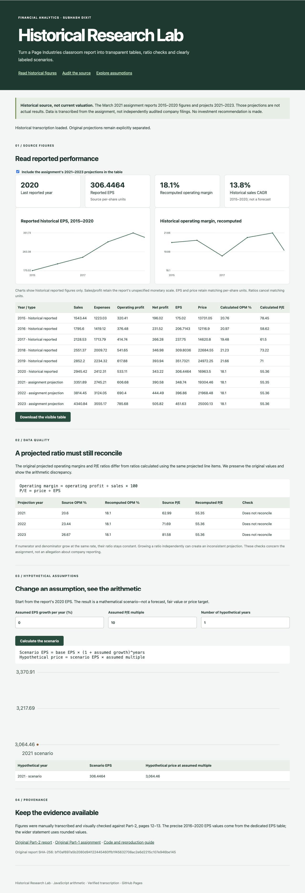
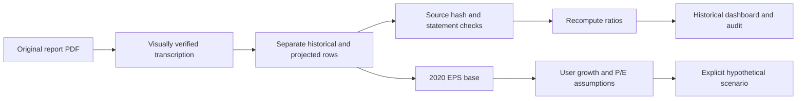
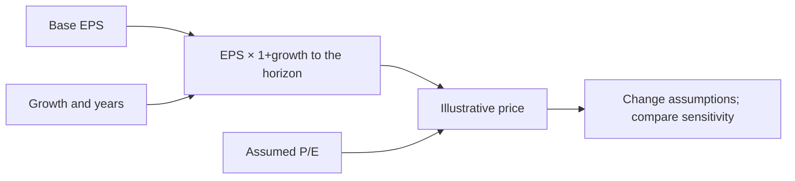
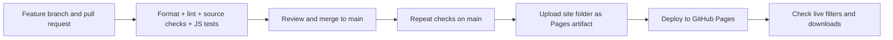

# Page Industries Historical Research Lab

**Live application:** [Open Page Industries Research Dashboard](https://subhashdixit.github.io/page-industries-research-dashboard/) · [Source code](https://github.com/subhashdixit/page-industries-research-dashboard)

A browser dashboard that turns an existing financial-analysis assignment into a transparent historical research tool. Read the 2015–2020 figures, distinguish the assignment's 2021–2023 projections, audit inconsistent ratios and try a clearly hypothetical EPS/P-E scenario.

This is **not a live stock-price service, a verified company filing database or an investment recommendation**. Its source is the original report PDFs retained in [Part-1](Part-1) and [Part-2](Part-2).



## Start here

1. Read the historical sales, operating profit, EPS and source-price charts.
2. Choose a historical period and inspect the source table.
3. Enable **assignment projections** only if you want to see the report's old future assumptions. They are not relabelled as actual 2021–2023 outcomes.
4. Inspect the ratio audit to compare reported ratios with ratios recomputed from the displayed numerators and denominators.
5. Set hypothetical EPS growth, a horizon and a P/E multiple to learn how a scenario works. This is a sensitivity calculation from the historical 2020 base, not a current target price.
6. Export the table for your own review and follow the original PDF source links.

## Source and boundaries

Selected figures were manually transcribed and visually checked against **pages 12–13 of Part-2/Part-2.pdf**. Its SHA-256 is recorded in `site/data.json` and checked by `scripts/check_data.py`. The original document remains unchanged.

| Period | Status in this app | Interpretation |
|---|---|---|
| 2015–2020 | Historical values reported in the assignment | Not independently reconciled to audited filings. |
| 2021–2023 | Assignment projections | Historical forecasts made in that report, not actual outcomes. |
| New scenario | Hypothetical user assumptions | Arithmetic illustration, not a fitted predictive model. |

The source table does not clearly establish the sales/profit unit scale, so the app does not invent a crore/million label. Ratios divide matching source units. EPS and price are handled in their matching source per-share units. Price observation dates/adjustments are not established; the table cannot support a total-return backtest.



## Financial concepts and calculations

**Operating profit** is sales minus operating expenses in the source table. **Operating margin** asks how much operating profit is left for each unit of sales: `100 × operating profit / sales`. It helps compare operating efficiency, but accounting choices, business mix and one-off items can affect comparisons.

**EPS**, or earnings per share, expresses earnings against the source's share count. Increasing EPS may reflect improved earnings or changes in shares; it is not automatically improved cash generation. **P/E** is price divided by EPS. A higher multiple can reflect growth expectations or overvaluation; a lower multiple can reflect risk or a bargain. Neither determines value by itself.

**CAGR** over `n` year intervals is `(ending / beginning)^(1/n) - 1`. There are five intervals between 2015 and 2020, not six. CAGR smooths the path and hides volatile intermediate years.

For a hypothetical EPS of 100, 10% annual EPS growth for two years produces `100 × 1.10² = 121`. At an assumed P/E of 20, the scenario price is `121 × 20 = 2,420`. This is a multiplication of assumptions, not proof that a market will pay that multiple. The app uses the source 2020 EPS as its actual scenario base.



## Why the ratio audit is part of the app

Some projected ratios in the assignment do not agree with its underlying figures. For example, 2021 projected operating profit `606.68` divided by sales `3351.89` implies about **18.10%**, while the source prints **20.60%**. Price `19304.46` divided by EPS `348.74` implies approximately **55.35**, while the source prints **62.99**.

The app preserves the source entries and shows the recalculation side by side. It does not silently “correct” the PDF or treat an assignment inconsistency as a claim about the company's audited accounts. Rounding tolerance is applied to the operating-statement identity, and missing denominators produce unavailable ratios rather than fabricated zeros.

## Structure, tests and updates

```text
Part-1/ and Part-2/          original reports, preserved
site/data.json              verified selected figures and provenance
site/lib.js                 ratios, CAGR, scenario and audit functions
site/app.js                 controls and safe DOM rendering
site/charts.js              SVG visualization helpers
scripts/check_data.py       PDF identity and accounting checks
tests/                      calculation and invalid-input tests
.github/workflows/pages.yml checked static publishing
```

Tests cover CAGR intervals, missing denominators, bounded scenario inputs, source-ratio discrepancies and historical/projected separation. They verify the software's interpretation, not the authenticity of the report's historical financial figures. To replace this assignment source with verified filings, cite each filing, establish units and observation dates, update the source metadata, then independently reconcile the table before publishing.

Clone with `git clone https://github.com/subhashdixit/page-industries-research-dashboard.git`, then `cd page-industries-research-dashboard` before using the commands below.

## Run and understand the code

This is a **static application**: HTML provides structure, CSS provides presentation, JavaScript computes the visible analysis and SVG draws charts. It needs no Flask process, model server, API key or database. GitHub Pages can serve these files; it cannot run a Python backend.

Use Python 3.10+ for data checks and a local HTTP server, and Node.js 22+ for the JavaScript tests. Do not open `index.html` using `file://`, because browsers restrict local module/data loading.

```bash
python3 -m venv .venv
source .venv/bin/activate
python -m pip install black==25.1.0 pylint==3.3.8
python -m black --check scripts
python -m pylint scripts
node --test tests/*.test.js
python scripts/check_data.py
python -m http.server 8000 --directory site
```

Open `http://127.0.0.1:8000`. `site/` is the complete deployed website. Data preparation/verification code is in `scripts/`, tests in `tests/`, and the original report/notebook remains outside the deployed artifact. Text is inserted through safe DOM APIs; charts and controls are keyboard-accessible HTML/SVG with responsive layouts. Browser filtering is not server-side data storage.

## GitHub Pages release pipeline



The repository workflow `.github/workflows/pages.yml` tests PRs but only publishes from `main`. Set **Settings → Pages → Source → GitHub Actions**. In Actions, verify `Build and test` and `Deploy to GitHub Pages`. The deployment creates the public HTTPS website from the exact static artifact.

**CI** runs checks automatically when code changes. It catches data corruption, arithmetic regressions and syntax mistakes before release; it does not prove the historical source is correct. **CD** publishes the checked artifact. Least-privilege workflow permissions distinguish reading source, uploading an artifact and deploying Pages. Action dependencies are pinned to reviewed commit hashes.

GitHub is the source-code host; Pages is the static website host. A deployment changes the version visitors receive. There is no Docker requirement here: a browser already supplies the runtime. Adding a Python container would require a separate server host and adds no benefit to this app's calculation.

**Versioning and rollback:** each Git commit versions data and code together. Tag a known-good revision. Revert a bad change in a PR and let the same workflow publish the restored content. A repository rename changes the project Pages URL, so update README/homepage links afterwards. Pages and client caches may take a short time to refresh. Keep source and data notices in the deployed artifact.

The app is historical and has no live ingestion schedule. To update it, explicitly review new source coverage, change the data preparation/transcription, run the checks, and publish a new version. No paid service or secret is required for this public static deployment. Read [GitHub Pages documentation](https://docs.github.com/en/pages/getting-started-with-github-pages/what-is-github-pages) for current service limits.
